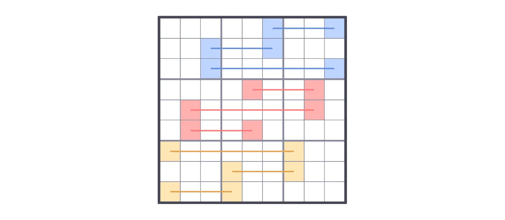
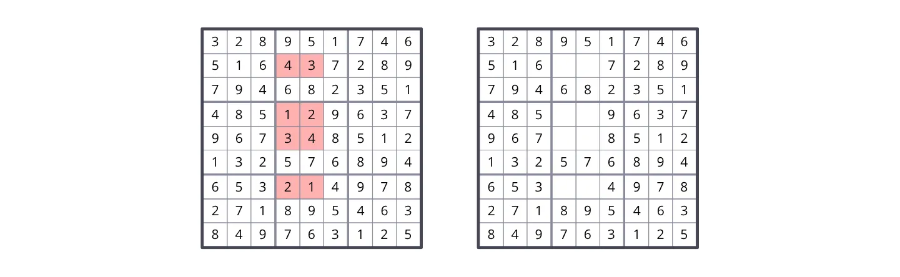
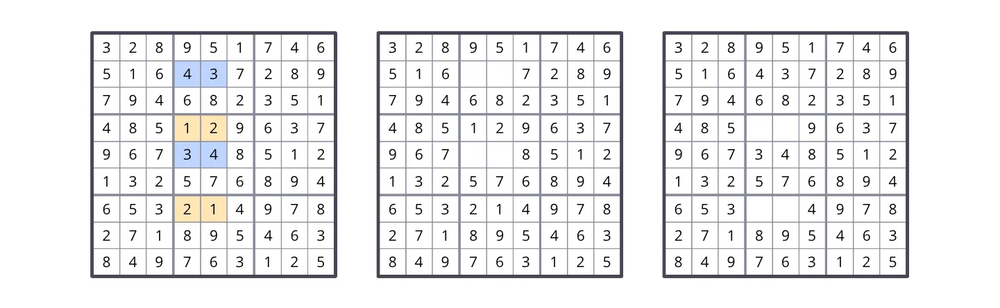
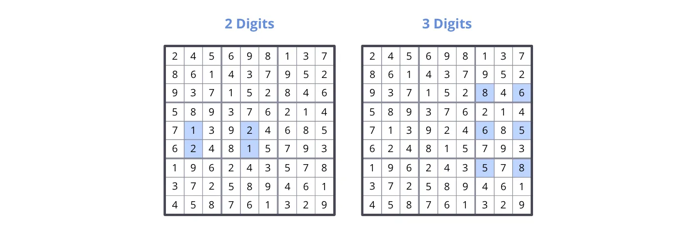
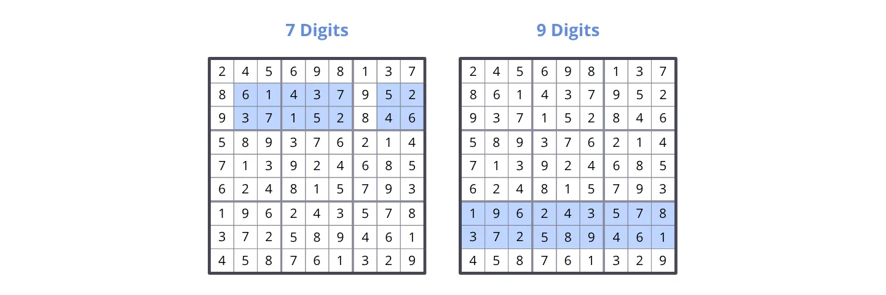
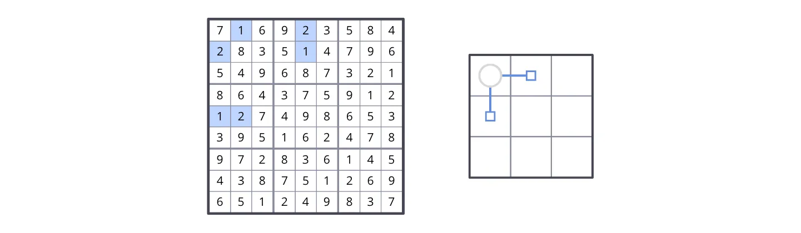
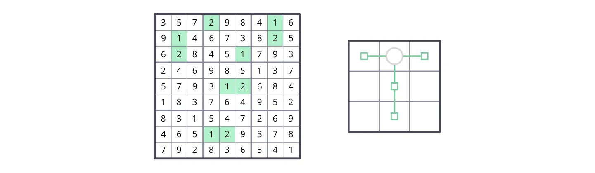
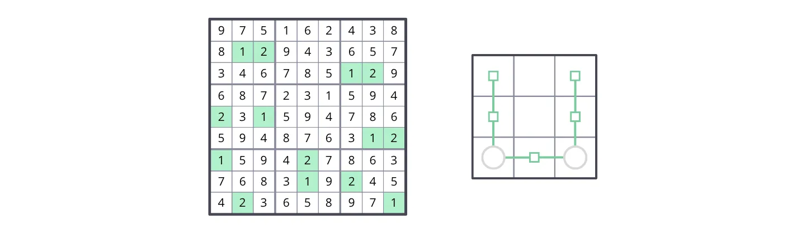
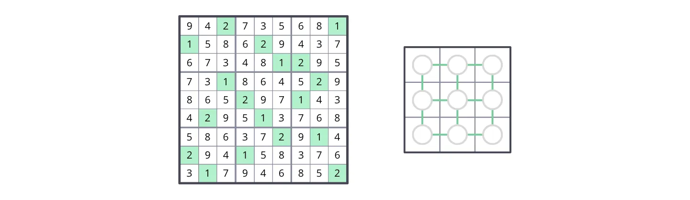

# Analysis of Minimal Unavoidable Sets

## INTRODUCTION
In this document I attempt to analyze and classify the structure of some (not all) minimal unavoidable sets in Sudoku.

The names and terminology I use might not be the best or might conflict with other Sudoku terms. If you know of better alternatives, please let me know.

If you notice any mistakes, incorrect statements, confusing or incomplete explanations, or think of some information that could be added to this document, please feel welcome to correct me and make suggestions.

I’m not an expert in Sudoku. I’m just sharing information and ideas I’ve been thinking about and find interesting.

## SOME DEFINITIONS
### What is an unavoidable set?
An unavoidable set is a set of cells in a solved Sudoku grid that, if we remove its digits, produces an incomplete grid with more than one possible solution.

### What is a minimal unavoidable set?
Some unavoidable sets contain other unavoidable sets, meaning that a subset of the cells of the unavoidable set form another unavoidable set. A minimal unavoidable set is a set that does not contain other unavoidable sets.

### Examples

  
- 000000000000430000000000000000120000000340000000000000000210000000000000000000000
  
- 328951746516437289794682351485129637967348512132576894653214978271895463849763125

Above is an example of an unavoidable set in a complete grid. When we remove the digits from the cells of the unavoidable set, the resulting incomplete grid has more than one solution (you can try finding all the solutions).

However, that unavoidable set contains two minimal unavoidable sets.

By removing only the digits from the cells of one of the two minimal unavoidable sets, we also get an incomplete grid with more than one solution.

It is important to note that, as long as any cell in a minimal unavoidable set isn’t empty, and all the cells in the grid that do not belong to the set are filled, the digits in all of the other cells in the set can be deduced. In other words, filling any cell in the set eliminates the ambiguity (multiple solutions) produced by leaving all cells of the set empty.

## SOME BASIC TYPES OF MINIMAL UNAVOIDABLE SETS

### The AB-BA-AB type

  
- 010020000020000010000010020000000000000000000000000000000000000000000000000000000

- 719823456325649718486715923698371542154982637237456891961538274542167389873294165

Characteristics:
- Only has two digits.
- Occupies at least all three boxes in a band or stack.

### The ABC-BCA type

  
- 000000000000000000000000000000000000000000000000000000001000200002000300003000100

Characteristics:
- Occupies at least two boxes in a band or stack.

### The chain type

- 000000000000000000000000000000000000010020000020010000000000000000000000000000000

- 000000000000000000000000806000000000000000605000000000000000508000000000000000000
  
- 205698107000000000907152806000000000000000000000000000000000000000000000000000000

- 000000000000000000000000000000000000000000000000000000196243578372589461000000000

- 245698137861437952937152846589376214713924685624815793196243578372589461458761329
  

Characteristics:
- Has between 2 and 9 digits.
- Occupies at least two boxes in a band or stack.

## THE CONNECTIVITY STRUCTURE

The previous images of minimal unavoidable sets show sets that occupy only one band or stack. However, these types of sets can occupy many boxes of other bands and stacks.

Below is an example of a minimal unavoidable set of the chain type with two digits, occupying boxes of many bands and stacks, and with a simple connectivity structure.

- 010020000200010000000000000000000000120000000000000000000000000000000000000000000

- 716923584283514796549687321864375912127498653395162478972836145438751269651249837
  

As you can see, this set has two extremes, in boxes 2 and 4, that are connected through the cells in box 1. I define the cells in box 1 as the “connector”.

I define the minimal unavoidable sets that have no connectors as sets with no connectivity structure.

### Connectors

A connector serves as a link between two parts of an unavoidable set that are in different bands and stacks. You can think of the previous example as 2 minimal unavoidable sets of the chain type, one in the first band and one in the first stack, and box 1 had the connector, merging both sets into one.

A connector is formed by 2 cells in a box that are in different columns and rows. If 2 cells belong to the same column or row within a box, they don’t form a connector.

### Examples of different connectivity structures

These are examples of grids with AB-BA-AB minimal unavoidable sets with different connectivity structures:

- 000200010010000020020001000000000000000012000000000000000000000000120000000000000

- 357298416914673825628451793246985137579312684183764952831547269465129378792836541
  

- 000000000012000000000000120000000000201000000000000012100020000000010200020000001

- 975162438812943657346785129687231594231594786594876312159427863768319245423658971
  

- 002000001100020000000001200001000020000200100020010000000002010200100000010000002

- 942735681158629437673481295731864529865297143429513768586372914294158376317946852
  

These are examples of grids with ABC-BCA minimal unavoidable sets with different connectivity structures:

Lastly, these are examples of minimal unavoidable sets of the chain type type, with different connectivity structures:

I haven’t completely figured out how it works, but I believe that, because the ABC-BCA type has three cells in each box, it can form up to three connectors per box, because a connector is formed by 2 cells and there are 3 ways of selecting 2 out of 3 cells. Each connector can connect different parts of a minimal unavoidable set. This allows for weird connectivity structures that I don’t fully understand yet and therefore can’t fully explain. Here is an example of a weird connectivity structures with an ABC-BCA set with up to two connectors on the same box:

### Some inferences

Because of how the distribution of digits works in solved grids, you can choose any pair of digits, and observe that they form minimal unavoidable sets of the AB-BA-AB type and/or the chain type, with different connectivity structures.

The set of 18 cells containing any two selected digits (which is an unavoidable set) can be partitioned into one or more minimal unavoidable sets of the AB-BA-AB type and/or the chain type.

Therefore, for each pair of digits, you can find at least one minimal unavoidable set of the AB-BA-AB or chain type in any grid. And because there are 36 different pairs of digits, any grid has at least 36 distinct minimal unavoidable sets of the AB-BA-AB and/or chain types.

Also, any selected pair of rows or columns in the same band or stack is an unavoidable set. That unavoidable set can be partitioned into one or more minimal unavoidable sets of the chain type only. This is also guaranteed by how the distribution of digits in solved grids work.

Therefore, because each band and stack has 3 ways of selecting 2 out of its 3 rows or columns, and there are 3 bands and 3 stacks (6 in total), there are at least 18 (3 multiplied by 6) minimal unavoidable sets of the chain type in any grid.

