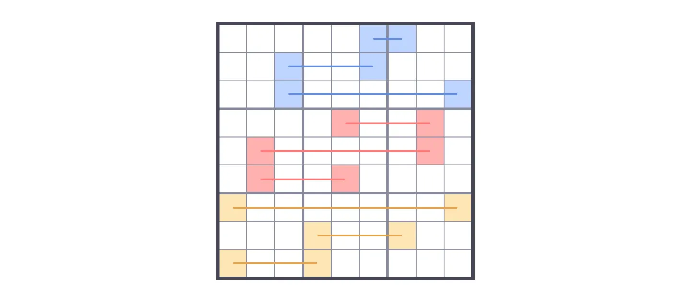

# Analysis of Minimal Unavoidable Sets

## INTRODUCTION
In this document I attempt to analyze and classify the structure of some (not all) minimal unavoidable sets in Sudoku.

The names and terminology I use might not be the best or might conflict with other Sudoku terms. If you know of better alternatives, please let me know.

If you notice any mistakes, incorrect statements, confusing or incomplete explanations, or think of some information that could be added to this document, please feel welcome to correct me and make suggestions.

I’m not an expert in Sudoku. I’m just sharing information and ideas I’ve been thinking about and find interesting.

## SOME DEFINITIONS
### What is an unavoidable set?
An unavoidable set is a set of cells in a solved Sudoku grid that, if we remove its digits, produces an incomplete grid with more than one possible solution.

### What is a minimal unavoidable set?
Some unavoidable sets contain other unavoidable sets, meaning that a subset of the cells of the unavoidable set form another unavoidable set. A minimal unavoidable set is a set that does not contain other unavoidable sets.

### Examples

Above is an example of an unavoidable set in a complete grid. When we remove the digits from the cells of the unavoidable set, the resulting incomplete grid has more than one solution (you can try finding all the solutions).

However, that unavoidable set contains two minimal unavoidable sets.

By removing only the digits from the cells of one of the two minimal unavoidable sets, we also get an incomplete grid with more than one solution.

It is important to note that, as long as any cell in a minimal unavoidable set isn’t empty, and all the cells in the grid that do not belong to the set are filled, the digits in all of the other cells in the set can be deduced. In other words, filling any cell in the set eliminates the ambiguity (multiple solutions) produced by leaving all cells of the set empty.

## SOME BASIC TYPES OF MINIMAL UNAVOIDABLE SETS

### The AB-BA type

Characteristics:
- Only has two digits.
- Occupies at least two boxes in a band or stack.
- Has two cells per box.

### The AB-BC-CA type

Characteristics:
- Only has three digits.
- Occupies at least all three boxes in a band or stack.
- Has two cells per box.
  
### The ABC-BCA type

Characteristics:
- Only has three digits.
- Occupies at least two boxes in a band or stack.
- Has three cells per box.
