# Analysis of Minimal Unavoidable Sets

## TABLE OF CONTENTS

- [INTRODUCTION](#introduction)
- [SOME DEFINITIONS](#some-definitions)
- [SOME BASIC TYPES OF MINIMAL UNAVOIDABLE SETS](#some-basic-types-of-minimal-unavoidable-sets)
- [THE CONNECTIVITY STRUCTURE](#the-connectivity-structure)
- [OVERLAP OF MINIMAL UNAVOIDABLE SETS](#overlap-of-minimal-unavoidable-sets)
- [MIXED STRUCTURES](#mixed-structures)
- [CONNECTOR CONFLICT](#connector-conflict)
- [APPLYING THE CONCEPTS](#applying-the-concepts)
- [FINAL WORDS](#final-words)

## INTRODUCTION
In this document I attempt to analyze and classify the structure of some (not all) minimal unavoidable sets in Sudoku.

The names and terminology I use might not be the best or might conflict with other Sudoku terms. If you know of better alternatives, let me know.

If you notice any mistakes, incorrect statements, confusing or incomplete explanations, or think of some information that could be added to this document, feel welcome to send me corrections and suggestions.

I’m not an expert in Sudoku. I’m just sharing information and ideas I’ve been thinking about and find interesting.

## SOME DEFINITIONS
### What is an unavoidable set?
An unavoidable set is a set of cells in a solved Sudoku grid that, if we remove its digits, produces an incomplete grid with more than one possible solution.

### What is a minimal unavoidable set?
Some unavoidable sets contain other unavoidable sets, meaning that a subset of the cells of the unavoidable set form another unavoidable set. A minimal unavoidable set is a set that does not contain other unavoidable sets.

### Examples

  
- 000000000000430000000000000000120000000340000000000000000210000000000000000000000
  
- 328951746516437289794682351485129637967348512132576894653214978271895463849763125

Above is an example of an unavoidable set in a complete grid. When we remove the digits from the cells of the unavoidable set, the resulting incomplete grid has more than one solution (you can try finding all the solutions).

However, that unavoidable set contains two minimal unavoidable sets.

By removing only the digits from the cells of one of the two minimal unavoidable sets, we also get an incomplete grid with more than one solution.

It is important to note that, as long as any cell in a minimal unavoidable set isn’t empty, and all the cells in the grid that do not belong to the set are filled, the digits in all of the other cells in the set can be deduced. In other words, filling any cell in the set eliminates the ambiguity (multiple solutions) produced by leaving all cells of the set empty.

## SOME BASIC TYPES OF MINIMAL UNAVOIDABLE SETS

### The AB-BA-AB type

  
- 010020000020000010000010020000000000000000000000000000000000000000000000000000000

- 719823456325649718486715923698371542154982637237456891961538274542167389873294165

Characteristics:
- Only has two digits.
- Occupies at least all three boxes in a band or stack.

### The ABC-BCA type

  
- 000000000000000000000000000000000000000000000000000000001000200002000300003000100

Characteristics:
- Occupies at least two boxes in a band or stack.

### The chain type

- 000000000000000000000000000000000000010020000020010000000000000000000000000000000

- 000000000000000000000000806000000000000000605000000000000000508000000000000000000
  
- 205698107000000000907152806000000000000000000000000000000000000000000000000000000

- 000000000000000000000000000000000000000000000000000000196243578372589461000000000

- 245698137861437952937152846589376214713924685624815793196243578372589461458761329
  

Characteristics:
- Has between 2 and 9 digits.
- Occupies at least two boxes in a band or stack.

## THE CONNECTIVITY STRUCTURE

The previous images of minimal unavoidable sets show sets that occupy only one band or stack. However, these types of sets can occupy many bands or stacks.

Below is an example of a minimal unavoidable set of the chain type with two digits, occupying many bands and stacks, and with a simple connectivity structure.

- 010020000200010000000000000000000000120000000000000000000000000000000000000000000

- 716923584283514796549687321864375912127498653395162478972836145438751269651249837
  

This set occupies boxes 1, 2 and 4. The parts in box 2 and 4 are connected through the 2 cells in box 1. I define those cells in box 1 as the “connector”.

When a minimal unavoidable set has no connectors, I refer to it as a set with no connectivity structure.

### Connectors

A connector serves as a link between two parts of an unavoidable set that are in different bands and/or stacks. You can think of the previous example as 2 minimal unavoidable sets of the chain type, one in the first band and one in the first stack, and box 1 had the connector, merging both sets into one.

A connector is formed by 2 cells in a box that are in different columns and rows. If 2 cells belong to the same column or row within a box, they don’t form a connector.

### Examples of different connectivity structures

These are examples of grids with AB-BA-AB minimal unavoidable sets with different connectivity structures:

- 000200010010000020020001000000000000000012000000000000000000000000120000000000000

- 357298416914673825628451793246985137579312684183764952831547269465129378792836541
  

- 000000000012000000000000120000000000201000000000000012100020000000010200020000001

- 975162438812943657346785129687231594231594786594876312159427863768319245423658971
  

- 002000001100020000000001200001000020000200100020010000000002010200100000010000002

- 942735681158629437673481295731864529865297143429513768586372914294158376317946852
  

These are examples of minimal unavoidable sets of the chain type, with different connectivity structures:

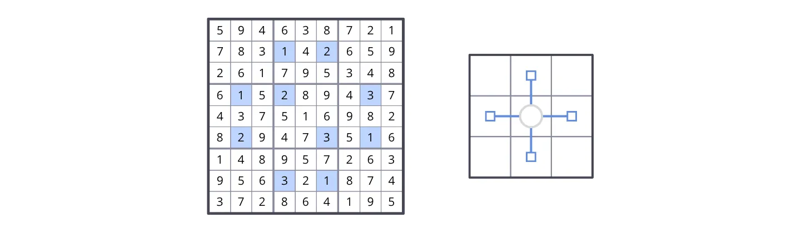

- 000000000000102000000000000010200030000000000020003010000000000000301000000000000

- 594638721783142659261795348615289437437516982829473516148957263956321874372864195
  

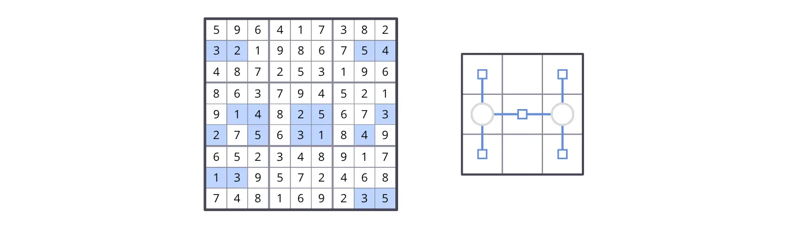

- 000000000320000054000000000000000000014025003205031040000000000130000000000000035

- 596417382321986754487253196863794521914825673275631849652348917139572468748169235
  

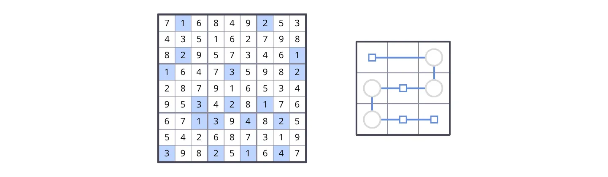

- 010000200000000000020000001100030002000000000003020100001304020000000000300201040

- 716849253435162798829573461164735982287916534953428176671394825542687319398251647
  

Lastly, these are examples of grids with ABC-BCA minimal unavoidable sets with different connectivity structures:

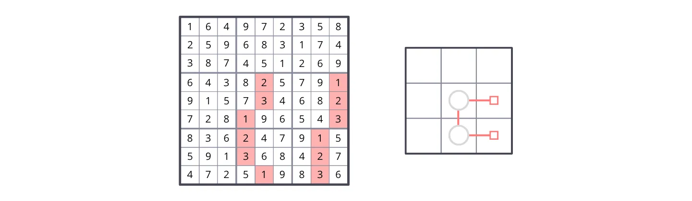

- 000000000000000000000000000000020001000030002000100003000200010000300020000010030

- 164972358259683174387451269643825791915734682728196543836247915591368427472519836
  

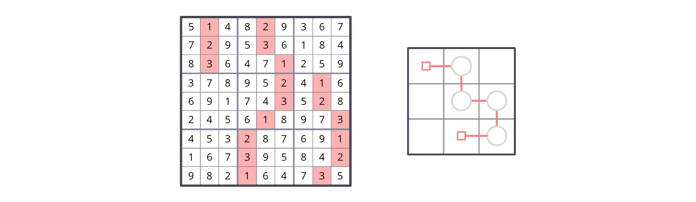

- 010020000020030000030001000000002010000003020000010003000200001000300002000100030

- 514829367729536184836471259378952416691743528245618973453287691167395842982164735
  

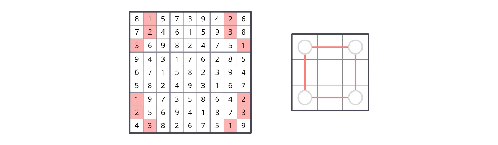

- 010000020020000030300000001000000000000000000000000000100000002200000003030000010

- 815739426724615938369824751943176285671582394582493167197358642256941873438267519
  

I find the ABC-BCA type to be more complex than the other two types of sets. I still don't completely understand all the ways it can have connectivity structures, and I'm not sure that the framework I defined is enough to understand it.

Also, I believe that, because the ABC-BCA type has three cells in each box, it can form up to three connectors per box, because a connector is formed by 2 cells and there are 3 ways of selecting 2 out of 3 cells. This might allow for weird connectivity structures. This phenomenon also applies to the chain type, but only when it has more than 2 digits.

### Some inferences

Because of how the distribution of digits works in solved grids, you can choose any pair of digits, and observe that they form minimal unavoidable sets of the AB-BA-AB type and/or the chain type, with different connectivity structures.

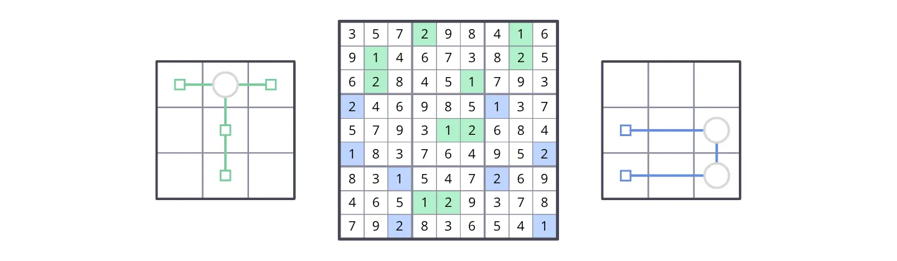

The set of 18 cells containing any two selected digits (which is an unavoidable set) can be partitioned into one or more minimal unavoidable sets of the AB-BA-AB type and/or the chain type.

Therefore, for each pair of digits, you can find at least one minimal unavoidable set of the AB-BA-AB or chain type in any grid. And because there are 36 different pairs of digits, any grid has at least 36 distinct minimal unavoidable sets of the AB-BA-AB and/or chain types.

Also, any selected pair of rows or columns in the same band or stack is an unavoidable set. That unavoidable set can be partitioned into one or more minimal unavoidable sets of the chain type only. This is also guaranteed by how the distribution of digits in solved grids work.

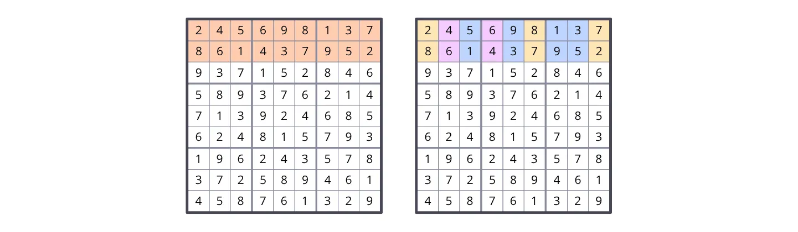

Therefore, because each band and stack has 3 ways of selecting 2 out of its 3 rows or columns, and there are 3 bands and 3 stacks (6 in total), there are at least 18 (3 multiplied by 6) minimal unavoidable sets of the chain type in any grid.

## OVERLAP OF MINIMAL UNAVOIDABLE SETS

Two minimal unavoidable sets can share some cells. I call that “overlap”. Below is an example of an AB-BA-AB type set and a chain type set sharing some cells.

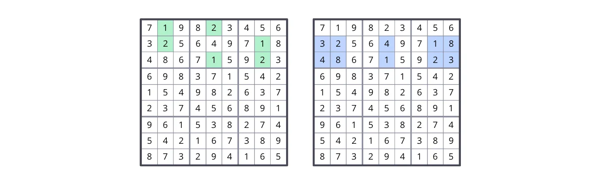

This means that each cell in the grid can be part of multiple minimal unavoidable sets.

## MIXED STRUCTURES

The previous examples with different connectivity structures had all parts of the same type (AB-BA-AB, chain, or ABC-BCA type), but that's not the only possibility. Some minimal unavoidable sets are the result of connecting parts of two or more different types of minimal unavoidable sets.

For example, below is a minimal unavoidable set with an AB-BA-AB type part, and a chain type part.

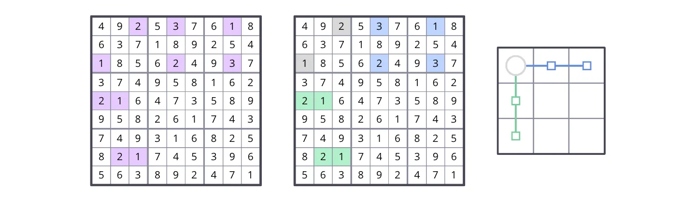

- 002030010000000000100020030000000000210000000000000000000000000021000000000000000

- 492537618637189254185624937374958162216473589958261743749316825821745396563892471
  

The connector is in box 1. The AB-BA-AB part is in the first stack (left to right), and the chain part is in the first band (top to bottom). The 2 different types of sets are connected by the connector in box 1. They stop being 2 individual sets and merge to form 1 new minimal unavoidable set, with what I call "mixed structure".

Here are more examples with different mixes and connectivity structures:

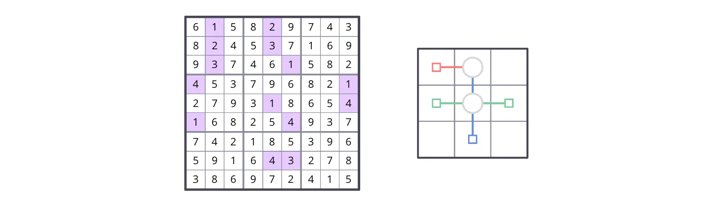

- 010020000020030000030001000400000001000010004100004000000000000000043000000000000

- 615829743824537169937461582453796821279318654168254937742185396591643278386972415
  

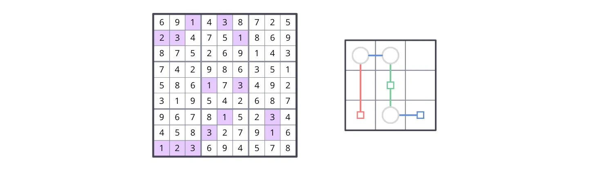

- 001030000230001000000000000000000000000103000000000000000010030000300010123000000

- 691438725234751869875269143742986351586173492319542687967815234458327916123694578
  

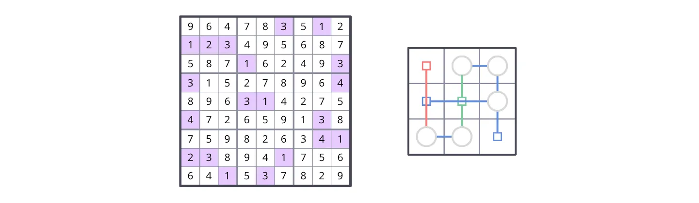

- 000003010123000000000100003300000004000310000400000030000000041230001000001030000

- 964783512123495687587162493315278964896314275472659138759826341238941756641537829
  

## CONNECTOR CONFLICT

There is a particular type of minimal unavoidable set that is produced by what I call “connector conflict”.

To explain this concept, let’s start with this:

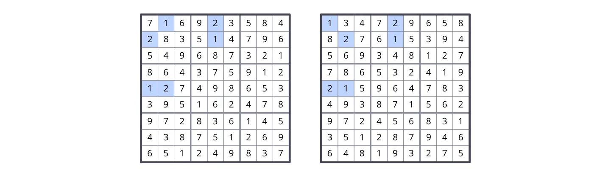

Above you can see two grid examples with similar chain type sets, each with connector cells in the same 2 columns and 2 rows, but in different positions. This illustrates that, as long as the connector cells are in the correct columns and rows, they can be positioned in 2 different ways.

Of course, in a solved grid, the position of the connector cells is already determined, but if the grid is not solved, a unique position of the connector cells is not always possible to determine.

Now let’s look at the following example showing two AB-BA-AB type sets in the same grid, both with a connector in box 5, with cells in the same 2 columns and 2 rows.

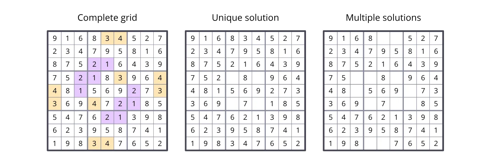

- 000000000000000000000210000002100000001000200000002100000021000000000000000000000

- 000034000000000000000000000000003004400000003300400000000000000000000000000340000

- 916834527234795816875216439752183964481569273369472185547621398623958741198347652
  

If we remove only the digits from both connectors, the incomplete grid still has an unique solution, because we can still deduce the positions of the missing digits thanks to the digits in the rest of both minimal unavoidable sets. But if we remove some of the other digits from both sets as well, the grid would have more than 1 solution.

This happens because, by removing those other digits, we lose the information necessary to determine which connector’s cells go in which position, so both ways of positioning the connector cells become possible:

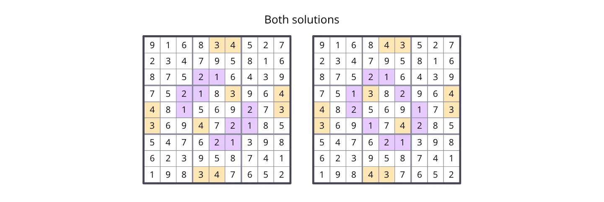

So, a connector conflict occurs when 2 connectors use the same 2 columns and 2 rows in a box, and there aren’t other digits to determine how the cells of each connector are positioned.

### Other than the digits of the connectors, what digits should be removed to produce a connector conflict?

I’m not completely sure and can’t rigorously prove and explain how this works. However, I can give an explanation based on what I understand.

First, we have to consider that for a connector conflict to occur we need 2 connectors in the same box and the same 2 columns and rows. Each connector links 2 parts of a minimal unavoidable set. So, we are considering 2 connectors, 2 parts linked to one connector, and 2 parts linked to the other connector.

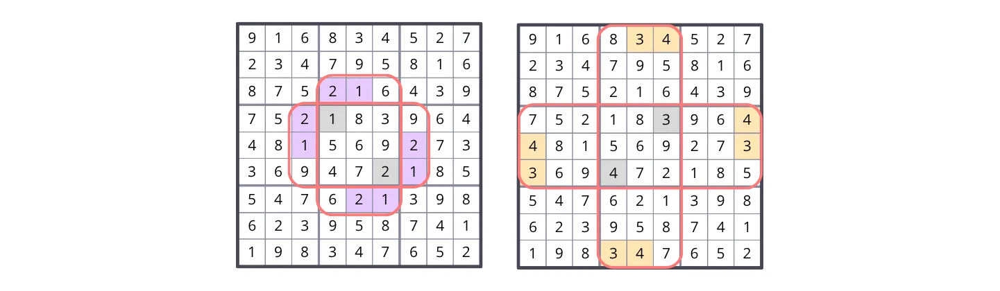

Now, to produce a connector conflict, we need to remove the digits in both connectors, the digits in one of the 2 parts linked to one connector, and the digits in one of the 2 parts linked to the other connector. That should be enough to create the ambiguity necessary to produce a connector conflict.

Because, for each connector, we have 2 options of parts from which to remove digits, there are 4 different minimal unavoidable sets that can be produced with the same connector conflict.

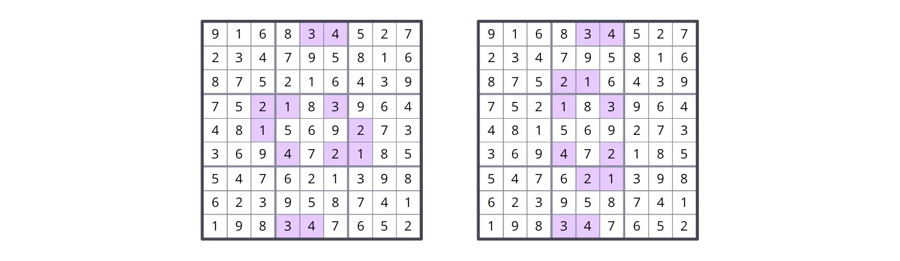

- 000034000000000000000000000002103000001000200000402100000000000000000000000340000

- 000034000000000000000210000000103000000000000000402000000021000000000000000340000
  

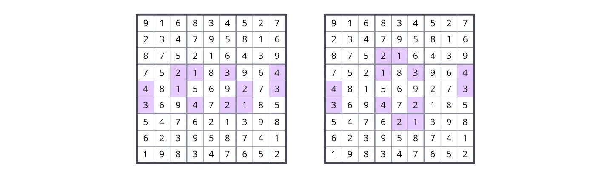

- 000000000000000000000000000002103004401000203300402100000000000000000000000000000

- 000000000000000000000210000000103004400000003300402000000021000000000000000000000
  

### Reasoning about the minimum number of unavoidable sets produced by connector conflict

Every 2 cells within a box and in different columns and rows form a connector. If you select any 2 cells like this, you will see that they form a connector of at least an AB-BA-AB type set or a chain type set.

A connector conflict requires 2 connectors in the same box using the same 2 columns and 2 rows.

In a box, there are 3 ways of selecting 2 columns, and 3 ways of selecting 2 rows, so there are 9 cases of 2 connectors with the same 2 columns and 2 rows per box. There are 9 boxes, so the total number of possible connector conflicts is 81.

Previously I described how each connector conflict can produce 4 different unavoidable sets. This means that, in any grid, there are at least 324 (81 multiplied by 4) distinct unavoidable sets produced solely by connector conflict. 

I don’t know if these 324 unavoidable sets are also minimal, because I can’t rule out the possibility of some of the sets containing all the cells of a minimal unavoidable set, which would mean that those sets are not minimal.

## APPLYING THE CONCEPTS

Now I will use all the concepts described in this document to analyze the structure of a more complex minimal unavoidable set:

- 001200503230010000560000000312000000400320050050140300000000000000000000640000035

- 871264593239815746564793218312658974498327651756149382183576429925431867647982135
  

First, we can identify the following minimal unavoidable sets in the grid, which we will call sets A and B:

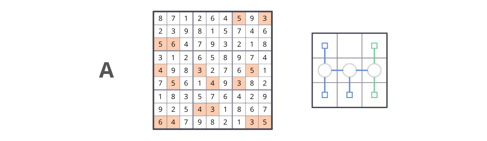

- 000000503000000000560000000000000000400300050050040300000000000000430000640000035

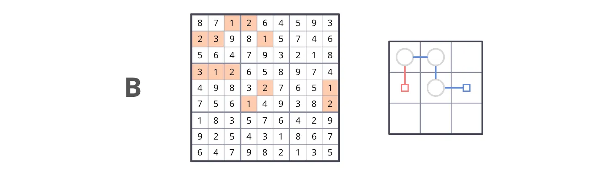

- 001200000230010000000000000312000000000020001000100002000000000000000000000000000

We can observe that both sets have a connector in box 5, with cells in the same 2 columns and 2 rows. This means that a connector conflict can occur with those connectors.

Here are the 2 parts that each connector is connecting:

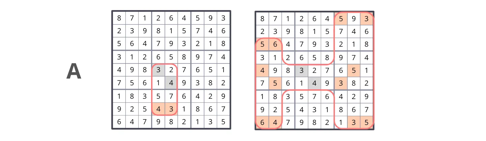

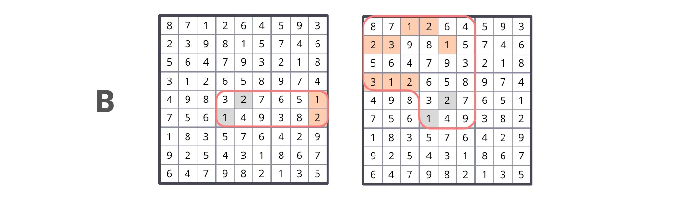

If we select 1 out of the 2 parts connected to each connector, we get 4 possible distinct combinations. This means that 4 minimal unavoidable sets can be produced thanks to the connector conflict:

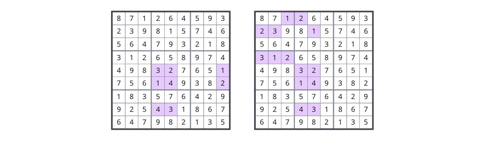

- 000000000000000000000000000000000000000320001000140002000000000000430000000000000

- 001200000230010000000000000312000000000320000000140000000000000000430000000000000

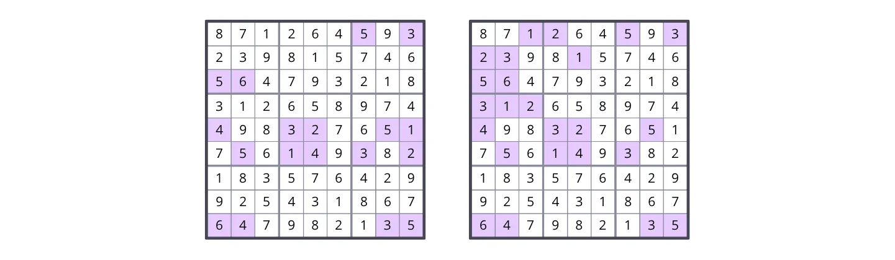

- 000000503000000000560000000000000000400320051050140302000000000000000000640000035

And, as we can see, one of those combinations is the minimal unavoidable set that we were analyzing.

This means that our initial minimal unavoidable set was produced by a connector conflict between 2 other minimal unavoidable sets with mixed structures (sets A and B).

## FINAL WORDS

All the minimal unavoidable sets in this document were designed by hand.

I believe that a computer would also be able to create and analyze minimal unavoidable sets that follow the rules and patterns described in this document, and it might be possible to develop a program to find all those minimal unavoidable sets for any given grid.

The concepts described in this document were conceived with the purpose of explaining the structure of minimal unavoidable sets. There are other minimal unavoidable sets that I can't yet explain with the concepts developed so far, so there is room for adapting and finding better ideas and explanations.
