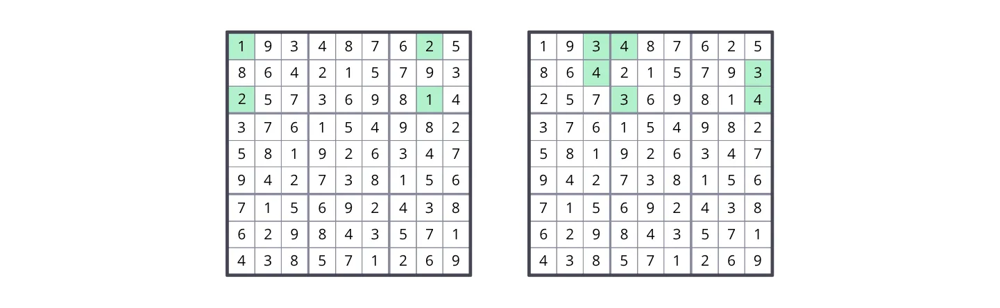

# Analysis of Minimal Unavoidable Sets

## INTRODUCTION
In this document I attempt to analyze and classify the structure of some (not all) minimal unavoidable sets in Sudoku.

The names and terminology I use might not be the best or might conflict with other Sudoku terms. If you know of better alternatives, please let me know.

If you notice any mistakes, incorrect statements, confusing or incomplete explanations, or think of some information that could be added to this document, please feel welcome to correct me and make suggestions.

I’m not an expert in Sudoku. I’m just sharing information and ideas I’ve been thinking about and find interesting.

## SOME DEFINITIONS
### What is an unavoidable set?
An unavoidable set is a set of cells in a solved Sudoku grid that, if we remove its digits, produces an incomplete grid with more than one possible solution.

### What is a minimal unavoidable set?
Some unavoidable sets contain other unavoidable sets, meaning that a subset of the cells of the unavoidable set form another unavoidable set. A minimal unavoidable set is a set that does not contain other unavoidable sets.

### Examples

  
- 000000000000430000000000000000120000000340000000000000000210000000000000000000000
  
- 328951746516437289794682351485129637967348512132576894653214978271895463849763125

Above is an example of an unavoidable set in a complete grid. When we remove the digits from the cells of the unavoidable set, the resulting incomplete grid has more than one solution (you can try finding all the solutions).

However, that unavoidable set contains two minimal unavoidable sets.

By removing only the digits from the cells of one of the two minimal unavoidable sets, we also get an incomplete grid with more than one solution.

It is important to note that, as long as any cell in a minimal unavoidable set isn’t empty, and all the cells in the grid that do not belong to the set are filled, the digits in all of the other cells in the set can be deduced. In other words, filling any cell in the set eliminates the ambiguity (multiple solutions) produced by leaving all cells of the set empty.

## SOME BASIC TYPES OF MINIMAL UNAVOIDABLE SETS

### The AB-BA type

  
- 100000020000000000200000010000000000000000000000000000000000000000000000000000000

- 003400000004000003000300004000000000000000000000000000000000000000000000000000000

- 193487625864215793257369814376154982581926347942738156715692438629843571438571269

Characteristics:
- Only has two digits.
- Occupies at least two boxes in a band or stack.
- Has two cells per box.

### The AB-BC-CA type

  
- 000000000000000000000000000000000000001020300002030100000000000000000000000000000

Characteristics:
- Only has three digits.
- Occupies at least all three boxes in a band or stack.
- Has two cells per box.
  
### The ABC-BCA type

  
- 000000000000000000000000000000000000000000000000000000010002000020003000030001000

Characteristics:
- Only has three digits.
- Occupies at least two boxes in a band or stack.
- Has three cells per box.

## THE CONNECTIVITY STRUCTURE

The previous images of minimal unavoidable sets show sets that occupy only one band or stack. However, these types of sets can occupy many boxes of other bands and stacks.

Below is an example of a minimal unavoidable set of the AB-BA type occupying boxes of many bands and stacks, with a simple connectivity structure.

As you can see, this set has two extremes, in boxes 2 and 4, that are connected through the cells in box 1. I define the cells in box 1 as the “connector”.

### Connectors

A connector serves as a link between two or more parts of an unavoidable set that are in boxes from different bands and stacks. In the previous example, boxes 2 and 4 belonged to different bands and stacks, and box 1 had the connector.

A connector is formed by 2 cells in a box that are in different columns and rows. If 2 cells belong to the same column or row within a box, they don’t form a connector.

### Examples of different connectivity structures

Below are examples of grids with AB-BA minimal unavoidable sets with different connectivity structures.

The examples above use the cells with the digits 1 and 2, but you can choose any pair of digits, and observe that they form minimal unavoidable sets of the AB-BA type, with different connectivity structures.

The set of 18 cells containing any two selected digits (which is an unavoidable set) can be partitioned into one or more minimal unavoidable sets of the AB-BA type. This is because of how the distribution of digits in solved grids works, and you can confirm it is the case for every grid.

Therefore, for each pair of digits, you can find at least one minimal unavoidable set of the AB-BA type in any grid. And because there are 36 different pairs of digits, any grid has at least 36 distinct minimal unavoidable sets of the AB-BA type.
